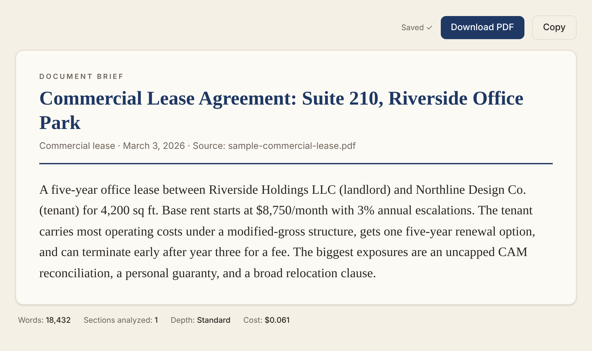
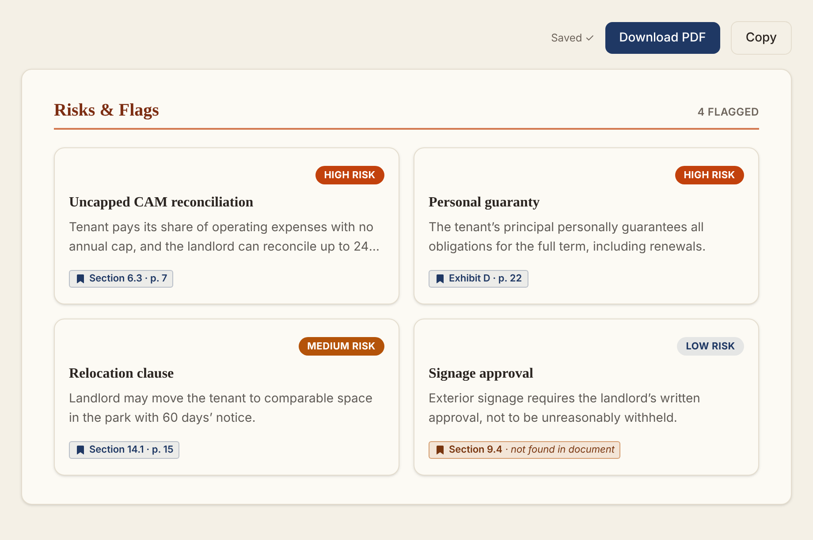
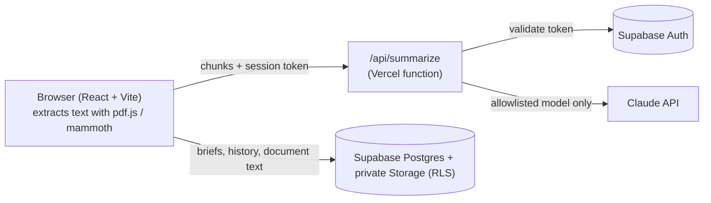

# DocBrief

**AI briefs for long contracts and business documents, with every citation checked against the source.**

[](https://github.com/zakarieamedia/docbrief/actions/workflows/ci.yml)

Upload a 60-page lease or purchase agreement and get back a structured brief: what the document is, who's involved, the money, the obligations and deadlines, and the risks, each one tied to the exact section and page it came from. Then ask follow-up questions in plain English.

I built it to review real estate and business agreements. Reading the AI's output was never the hard part. Trusting it was. So DocBrief checks the model's citations against the document itself before showing them.

| Overview | Risks & flags |
|---|---|
|  |  |

<sub>Screenshots use a fictional sample lease.</sub>

## Features

- **Upload** PDF, DOCX, TXT, CSV or Markdown files up to 25 MB. Text is extracted in the browser.
- **Choose a depth** (Brief, Standard, Deep or Executive) and an optional focus.
- **Structured brief:** an overview, a full narrative summary, parties, financial terms, obligations, key dates, and risks ranked by severity.
- **Ask questions** about the document. Answers come only from the document and cite a page or section.
- **Download** a styled PDF memo. Every analysis is saved to your history automatically.
- **See the cost first:** a token-based estimate before you run an analysis, and the actual cost recorded afterwards.

## How it works



**Map-reduce summarization.** Long documents are split into 150k-character chunks. Each chunk is reduced to key points, then a final pass combines them into one structured JSON brief. The depth setting controls narrative length, roughly 8–20% of the source with a cap.

**Citation verification** ([`src/lib/verify.js`](src/lib/verify.js)). The model is asked for a verbatim quote and a section reference for each risk.
- Quotes must match the document word for word after normalization. Otherwise the UI labels them "wording not verified".
- Section references are checked loosely, because labels get reformatted legitimately. Missing ones show as *not found in document*.
- Page numbers are computed from where the verified quote actually appears in the text, never taken from the model. If the quote appears on more than one page, no page is shown.

**Defensive parsing.** A small state machine (`repairJson` in [`src/lib/claude.js`](src/lib/claude.js)) repairs unescaped quotes and raw newlines that models sometimes leave inside long JSON strings. Placeholder rows like "Not specified" or "N/A" are removed before they reach the UI.

**Extraction warnings** ([`src/lib/extractionChecks.js`](src/lib/extractionChecks.js)). Heuristics catch two problems:
- Scanned pages, which have no extractable text.
- Table-heavy pages, where PDF extraction can scramble numbers.

In both cases the reader is told which pages to double-check.

**Security model.**
- The Anthropic key never reaches the browser.
- The serverless proxy validates the caller's Supabase session, forwards only allowlisted models, and caps `max_tokens`.
- Briefs are protected by Postgres row-level security.
- Uploaded document text is stored in a private bucket, scoped per user.

## Tech stack

| Layer | Tools |
|---|---|
| Frontend | React 19, Vite 7, Tailwind CSS v4, React Router |
| Backend | Vercel serverless function (Node) |
| Data & auth | Supabase (Postgres, Auth, Storage, RLS) |
| AI | Claude API: Sonnet for summaries, Haiku for Q&A |
| Documents | pdf.js, mammoth, jsPDF |
| Quality | Node test runner, GitHub Actions CI |

## Running it locally

You need Node 20+, a [Supabase](https://supabase.com) project, an [Anthropic API key](https://console.anthropic.com), and the [Vercel CLI](https://vercel.com/docs/cli).

1. Install dependencies.
   ```sh
   npm install
   ```
2. Set up the database. Run [`supabase/schema.sql`](supabase/schema.sql) in the Supabase SQL editor, replacing `admin@example.com` with your admin email first. Then:
   - create a **private** Storage bucket named `documents`
   - enable email auth
3. Copy `.env.example` to `.env.local` and fill it in.
4. Start the app.
   ```sh
   vercel dev
   ```
   This runs the frontend and the `/api/summarize` function together. Plain `npm run dev` serves the UI only.

Run the tests:

```sh
npm test
```

## Project structure

```
api/summarize.js          Serverless proxy: auth check, model allowlist, token cap
src/lib/claude.js         Chunking, map-reduce summarization, Q&A, JSON repair, cost
src/lib/verify.js         Citation and quote verification, page location
src/lib/extractionChecks.js  Scanned-page and table-page heuristics
src/lib/briefPdf.js       PDF memo export
src/components/           Upload, results views, Q&A chat, history
supabase/schema.sql       Tables, RLS policies, storage policies
test/                     Unit tests for the verification and extraction logic
```

## Known limitations

- Scanned PDFs are detected but not OCR'd.
- Q&A (Haiku) usage isn't included in the cost tracking yet.
- The model allowlist is defined in both the client and the proxy, and has to be kept in sync by hand.

---

Built by [Zakarie Amedia](https://github.com/zakarieamedia).
